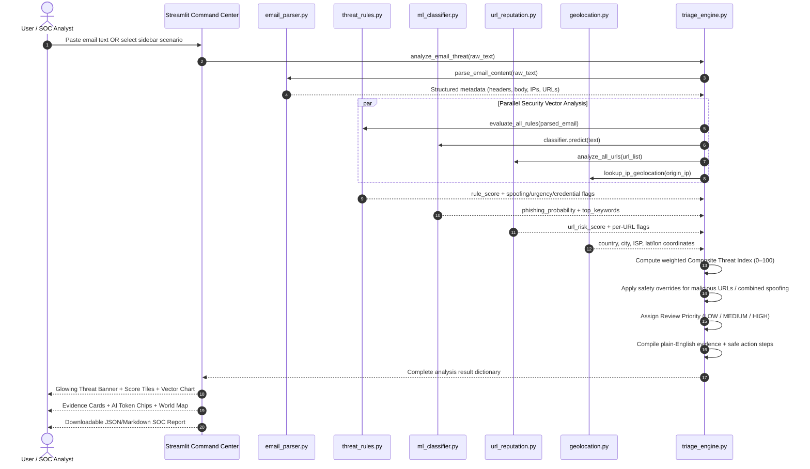

# 📘 Detailed Technical Documentation — SIH26106

> **AI-Powered Email Threat Detection, GeoLocation & Forensic Intelligence Platform**  
> Team `<Hypnexis '26>` • Manipal University Jaipur • Smart India Hackathon 2026

---

## Table of Contents
1. [Project Description](#-project-description)
2. [Problem Statement & Real-World Impact](#-problem-statement--real-world-impact)
3. [Complete Project Structure](#-complete-project-structure)
4. [Module-by-Module Technical Deep Dive](#-module-by-module-technical-deep-dive)
5. [Machine Learning Pipeline Details](#-machine-learning-pipeline-details)
6. [Threat Scoring Algorithm](#-threat-scoring-algorithm)
7. [End-to-End Data Flow](#-end-to-end-data-flow)
8. [Frontend Dashboard Architecture](#-frontend-dashboard-architecture)
9. [Pre-Configured Attack Scenarios](#-pre-configured-attack-scenarios)
10. [Deployment & Demo Instructions](#-deployment--demo-instructions)
11. [Security Considerations & Forensic Compliance](#-security-considerations--forensic-compliance)
12. [Future Enhancements & Roadmap](#-future-enhancements--roadmap)
13. [Tech Stack Summary](#-tech-stack-summary)
14. [Academic References & Standards](#-academic-references--standards)
15. [Team & Acknowledgements](#-team--acknowledgements)

---

## 📝 Project Description

The AI-Powered Email Threat Detection, GeoLocation and Forensic Intelligence Platform (SIH26106), developed by team `<Hypnexis '26>` from Manipal University Jaipur, is a privacy-first, human-in-the-loop screening tool designed to detect phishing, brand spoofing, and business email compromise without requiring mailbox login credentials. By analyzing pasted email text or raw RFC 822 headers, the platform combines heuristic domain rules, an explainable TF-IDF and Logistic Regression machine learning classifier, and PhishTank URL intelligence to flag deceptive senders, credential theft, and psychological urgency tactics. Crucially, it reconstructs intermediate `Received:` mail server hops to map the originating relay IP on an interactive globe in accordance with CISA forensic standards. Aggregating these multi-vector signals into a 0–100 Threat Index, the system assigns a clear review priority (**LOW**, **MEDIUM**, **HIGH**), provides plain-English evidence breakdowns with defensive checklists, and exports standardized SOC incident reports in JSON and Markdown for instant ticketing.

---

## 🎯 Problem Statement & Real-World Impact

### The Problem
According to the FBI's Internet Crime Complaint Center (IC3), phishing and business email compromise (BEC) attacks resulted in global losses exceeding **$2.9 billion in 2023 alone**. Indian organizations are among the most heavily targeted, with over **79% of Indian businesses** reporting phishing attempts in 2024 (Proofpoint State of the Phish Report).

Key challenges include:
- **Brand Impersonation:** Attackers forge display names like "PayPal Security Team" or "IT Support" while using unrelated email domains.
- **Psychological Coercion:** Urgency phrases like *"within 24 hours"*, *"account suspended"*, *"verify immediately"* bypass rational evaluation.
- **Deceptive Hyperlinks:** Shortened URLs, naked IP hosts, and typosquatted domains redirect users to credential harvesting pages.
- **Relay Obfuscation:** Multi-hop mail delivery chains obscure the true geographic origin of threats.
- **Skill Gap:** Non-technical users lack the tools to inspect raw email headers and decode spoofing patterns.

### Our Solution's Impact
| Metric | Without Our Platform | With Our Platform |
| :--- | :--- | :--- |
| Time to triage a suspicious email | 15–30 min (manual header analysis) | **< 3 seconds** (instant) |
| Spoofing detection accuracy | Varies by analyst skill | **Automated rule + ML hybrid** |
| Relay origin visibility | Requires command-line tools | **Interactive world map** |
| Evidence documentation | Manual copy-paste notes | **Auto-generated SOC JSON report** |
| Credential required from user | Often requires mailbox access | **Zero credentials needed** |

---

## 📁 Complete Project Structure

```
Hypnexis-2026-email-forensics/
│
├── .github/
│   └── workflows/
│       └── ci.yml                 # GitHub Actions CI pipeline
│
├── core/                          # Backend Processing Engines
│   ├── __init__.py                # Python package marker
│   ├── email_parser.py            # RFC 822 MIME header & body parser
│   ├── threat_rules.py            # Heuristic brand spoofing & urgency rules
│   ├── ml_classifier.py           # TF-IDF + Logistic Regression classifier
│   ├── url_reputation.py          # PhishTank, shortener & IP host analyzer
│   ├── geolocation.py             # IP-to-location resolver (live + offline)
│   └── triage_engine.py           # Multi-vector score aggregation & triage
│
├── data/                          # Training Data & Test Scenarios
│   ├── __init__.py                # Python package marker
│   ├── synthetic_dataset.py       # 28 curated labeled training examples
│   └── sample_emails.py           # 4 realistic attack/benign scenarios
│
├── app.py                         # Streamlit Cyber Command Center UI
├── test_engine.py                 # Automated verification test suite
├── requirements.txt               # Python dependencies
├── .gitignore                     # Git exclusions (cache, env, IDE)
├── LICENSE                        # MIT Open Source License
├── README.md                      # Primary project overview
└── DETAILED_README.md             # This document (in-depth documentation)
```

---

## 🔬 Module-by-Module Technical Deep Dive

### 1. `core/email_parser.py` — Email Parser & Header Normalizer

**Purpose:** Accepts raw pasted text (either full RFC 822 MIME format or plain message body) and extracts structured metadata.

**Key Capabilities:**
- Parses `From:`, `Reply-To:`, `Subject:`, `Date:` headers using Python's `email.parser` with the `email.policy.default` policy.
- Extracts display name vs. actual sender email address (e.g., `"PayPal Security" <attacker@phishing.xyz>`).
- Extracts all `Received:` headers in order and identifies public IPv4 addresses in each hop.
- Classifies IPs as public or private (filtering out `10.x.x.x`, `192.168.x.x`, `127.x.x.x`, etc.).
- Extracts all embedded URLs from body text using comprehensive regex patterns.
- Falls back to plain-text heuristic parsing when standard headers are absent.

**Output Schema:**
```python
{
    "sender_name": str,
    "sender_email": str,
    "sender_domain": str,
    "reply_to": str,
    "reply_to_domain": str,
    "subject": str,
    "origin_ip": str | None,
    "received_hops": [{"raw": str, "all_ips": list, "public_ips": list}],
    "urls": list[str],
    "body": str,
    "has_headers": bool
}
```

---

### 2. `core/threat_rules.py` — Heuristic Rule Evaluation Engine

**Purpose:** Pattern-based threat detection for social engineering tactics that statistical ML models might miss.

**Detection Categories:**

| Category | Rule Logic | Example Trigger |
| :--- | :--- | :--- |
| **Brand Spoofing** | Display name contains brand keyword but sender domain ≠ official domain | Name: "PayPal", Domain: `@phishing.xyz` |
| **Executive Impersonation** | Display name contains CEO/Director/Chancellor keywords from free webmail | Name: "Dr. Director", Domain: `@gmail.com` |
| **Reply-To Divergence** | Reply-To domain differs from sender domain | Sender: `@company.com`, Reply: `@evil.xyz` |
| **Suspicious TLD** | Sender domain uses high-abuse TLDs | `.xyz`, `.top`, `.click`, `.tk`, `.ru` |
| **Psychological Urgency** | Body contains coercive deadline/threat language | "within 24 hours", "account suspended" |
| **Credential/Financial** | Body solicits passwords, bank details, or gift cards | "verify your password", "wire transfer" |

**Scoring:** Each triggered rule contributes a weighted score (15–40 points), capped at 100.

---

### 3. `core/ml_classifier.py` — Explainable AI Text Classifier

**Purpose:** Statistical natural language processing to detect phishing vocabulary patterns that human-authored rules may not cover.

**Architecture:**
```
Raw Text → TfidfVectorizer (unigrams + bigrams, 2500 features) → LogisticRegression (C=2.0, balanced)
```

**Explainability (XAI):** After prediction, the system computes the **feature contribution** of each token present in the input by multiplying the token's TF-IDF weight by its Logistic Regression coefficient. The top 5 positive-contributing tokens are returned as human-readable evidence.

**Training Data:** 28 curated examples (14 phishing, 14 legitimate) covering diverse attack vectors: account suspension lures, CEO impersonation, fake invoices, lottery scams, IT helpdesk pretexts, and normal workplace communications.

---

### 4. `core/url_reputation.py` — URL Threat Intelligence

**Purpose:** Inspects every hyperlink embedded in the email for deceptive characteristics.

**Checks Performed:**
1. **PhishTank Cache Match:** Cross-references against a curated database of known phishing domains.
2. **Naked IP Host:** Flags URLs pointing to raw IP addresses (e.g., `http://185.193.125.10/login`).
3. **URL Shorteners:** Detects `bit.ly`, `tinyurl.com`, `t.co`, and 5 other known obfuscation services.
4. **High-Risk TLD:** Flags domains ending in `.xyz`, `.top`, `.click`, etc.
5. **Brand Subdomain Mimicry:** Detects patterns like `paypal.com.attacker.xyz` where a trusted brand name appears in a subdomain of an unrelated domain.
6. **Deep Subdomain Nesting:** Flags hostnames with more than 3 subdomain levels.

---

### 5. `core/geolocation.py` — IP-to-Geography Resolver

**Purpose:** Maps the originating relay server's IP address to an approximate physical location.

**Resolution Strategy:**
1. **Local Offline Cache (Priority 1):** Contains pre-resolved entries for all test scenario IPs, guaranteeing zero-latency demo performance regardless of network availability.
2. **Live API Query (Priority 2):** Queries `ip-api.com` with a 3-second timeout for real-world IP resolution.
3. **Heuristic Fallback (Priority 3):** Returns a generic "Undetermined Origin" result if both cache and API fail.

**Forensic Disclaimer:** Every geolocation result includes a prominently displayed CISA-aligned notice:
> *"IP geolocation reflects intermediate mail transfer agents (MTAs), relays, or proxies recorded in message headers. Geolocation is approximate and does NOT constitute legal proof of the original author or sender identity."*

---

### 6. `core/triage_engine.py` — Composite Score Aggregation & Triage

**Purpose:** The "supreme court judge" that fuses all analysis vectors into a single actionable verdict.

**Composite Score Formula:**
```
Composite = (Rule Score × 0.35) + (ML Score × 0.35) + (URL Score × 0.30)
```

**Safety Overrides:**
- If any URL is flagged `MALICIOUS`: floor score at 80.
- If sender spoofing + urgency/credential detected together: floor score at 75.

**Review Priority Assignment:**
| Composite Score | Priority | Color | Action Guidance |
| :---: | :--- | :--- | :--- |
| 60–100 | **HIGH** | 🔴 Red | Do NOT click links, do NOT reply, verify via alternate channel |
| 30–59 | **MEDIUM** | 🟠 Orange | Inspect sender carefully, hover over links, seek confirmation |
| 0–29 | **LOW** | 🟢 Green | Standard hygiene, report if anything unexpected arises |

---

## 🧠 Machine Learning Pipeline Details

### Feature Engineering
| Parameter | Value | Rationale |
| :--- | :--- | :--- |
| Vectorizer | `TfidfVectorizer` | Captures term importance relative to corpus |
| N-gram Range | `(1, 2)` | Captures both single words and bigrams like "wire transfer" |
| Max Features | 2,500 | Sufficient vocabulary coverage without overfitting |
| Sublinear TF | `True` | Dampens the effect of very frequent terms |
| Stop Words | English | Removes noise words like "the", "is", "and" |
| Classifier | `LogisticRegression` | Fast, interpretable, coefficient-based explainability |
| Regularization | `C=2.0` | Moderate regularization for small dataset |
| Class Weighting | `balanced` | Compensates for any class size imbalance |

### Explainability Methodology
For every classified email, the system:
1. Transforms the input text into a TF-IDF vector.
2. Identifies all non-zero feature indices (tokens present in the text).
3. For each present token, computes: `contribution = tfidf_weight × logistic_coefficient`.
4. Filters to positive-contributing tokens (pushing towards "phishing" class).
5. Sorts by contribution magnitude and returns the top 5 as evidence.

---

## 🔄 End-to-End Data Flow



---

## 🖥️ Frontend Dashboard Architecture

The interactive web interface is built with **Streamlit** and features a **Cyber Defense Command Center** aesthetic.

### Visual Components
| Component | Location | Description |
| :--- | :--- | :--- |
| **Radar Pulse Sidebar** | Left Panel | Animated green pulse showing live engine health status |
| **Glowing Threat Banner** | Top of page | Dynamically switches Red/Orange/Green with glow effects |
| **Glass Metric Tiles** | Below banner | 4 hover-animated tiles showing Composite, ML, Rule, URL scores |
| **Threat Vector Bar Chart** | Tab 2 (Left) | Altair horizontal chart comparing 5 threat dimensions |
| **Trigger Word Chips** | Tab 2 (Left) | Neon-bordered monospace chips showing AI's influential tokens |
| **Forensic Evidence Cards** | Tab 2 (Right) | Color-coded severity cards with plain-English explanations |
| **Interactive World Map** | Tab 3 | Streamlit map widget plotting relay server coordinates |
| **Hop-by-Hop Trace Nodes** | Tab 3 | Visual routing nodes showing `Received:` delivery chain |
| **URL Intelligence Table** | Tab 4 | Sortable dataframe with per-URL verdicts and flags |
| **SOC Report Exporter** | Tab 5 | Download buttons for JSON and Markdown incident packages |

---

## 🧪 Pre-Configured Attack Scenarios

### Scenario 1: Spoofed PayPal Credential Phishing (HIGH)
- **Display Name:** "PayPal Security Team"
- **Actual Domain:** `paypal-update-center.net` (NOT `paypal.com`)
- **Reply-To Trap:** Routes to `secure-banking-alert.xyz`
- **Relay Origin:** Moscow, Russian Federation (`185.193.125.10`)
- **Urgency:** "within 24 hours", "permanently deactivated"
- **Malicious URL:** Matches PhishTank blacklist
- **Expected Score:** ~88/100 (HIGH)

### Scenario 2: CEO Wire Transfer / Gift Card BEC (HIGH)
- **Display Name:** "Dr. Rajesh Sharma (Director)"
- **Actual Domain:** `gmail.com` (free webmail impersonating executive)
- **Relay Origin:** Lagos, Nigeria (`198.51.100.42`)
- **Financial Solicitation:** Wire transfer + gift card codes
- **Expected Score:** ~75/100 (HIGH)

### Scenario 3: IT Helpdesk Credential Harvesting (HIGH)
- **Display Name:** "IT Support Helpdesk"
- **Actual Domain:** `enterprise-portal.top` (suspicious TLD)
- **Shortened Link:** `bit.ly/urgent-verify-2026` hiding final destination
- **Urgency:** "credentials expire in 48 hours"
- **Expected Score:** ~80/100 (HIGH)

### Scenario 4: Legitimate Team Sprint Sync (LOW)
- **Display Name:** "Priya Nair"
- **Actual Domain:** `manipal.edu` (verified institutional domain)
- **Relay Origin:** Mountain View, USA / Google (`142.250.190.46`)
- **Content:** Normal hackathon team meeting coordination
- **Expected Score:** ~13/100 (LOW)

---

## 🚀 Deployment & Demo Instructions

### Local Development Setup
```bash
# 1. Clone the repository
git clone https://github.com/kc100official-cmd/Hypnexis-2026-email-forensics.git
cd Hypnexis-2026-email-forensics

# 2. Install dependencies
pip install -r requirements.txt

# 3. Verify backend engines (automated test)
python test_engine.py

# 4. Launch the web dashboard
python -m streamlit run app.py
# Opens at http://localhost:8501
```

### Live Demo Procedure (For Judges)
1. Open the dashboard in a browser.
2. Select **Scenario 1 (PayPal Spoof)** from the sidebar → observe the **RED glowing banner**, threat score **88/100**, and Moscow relay on the world map.
3. Switch to **Scenario 4 (Safe Sprint Sync)** → banner turns **GREEN**, score drops to **13/100**, evidence reads "benign communication patterns."
4. Navigate to **Tab 5** → download a JSON incident report with one click.

---

## 🔒 Security Considerations & Forensic Compliance

### Privacy Guarantees
- **Zero Credential Requirement:** The platform never requests mailbox passwords, OAuth tokens, or API keys from the user's email provider.
- **Ephemeral Processing:** All submitted email text is processed entirely in-memory during the active session and is never written to disk, logged to files, or transmitted to external servers.
- **No Telemetry:** The application does not collect analytics, usage metrics, or behavioral data.

### Forensic Standards Alignment
- **CISA Phishing Guidance:** The platform's detection patterns align with CISA's "Secure Our World" phishing recognition guidelines.
- **RFC 5321/5322 Compliance:** Email parsing adheres to Internet Message Format and SMTP standards.
- **Chain of Custody Awareness:** The SOC report includes incident IDs, timestamps, and forensic disclaimers suitable for preliminary incident response documentation.

### Limitations & Honest Disclosure
- IP geolocation identifies mail relay infrastructure, NOT the physical identity of the attacker.
- The ML classifier is trained on a curated synthetic dataset; production deployment would benefit from larger, real-world corpora (e.g., Nazario phishing corpus, APWG feeds).
- URL reputation uses a static PhishTank cache simulation; a production system would integrate live API feeds with rate limiting.

---

## 🔮 Future Enhancements & Roadmap

| Phase | Enhancement | Description |
| :--- | :--- | :--- |
| **v2.0** | DKIM/SPF/DMARC Verification | Validate cryptographic email authentication headers |
| **v2.0** | Attachment Sandboxing | Static analysis of PDF/Office macro attachments |
| **v2.5** | Live PhishTank API Integration | Real-time URL reputation queries with caching |
| **v2.5** | Transformer-Based NLP Model | Replace TF-IDF with BERT/DistilBERT for higher linguistic accuracy |
| **v3.0** | Browser Extension | One-click email scanning directly from Gmail/Outlook web interfaces |
| **v3.0** | Multi-Language Support | Detect phishing in Hindi, Tamil, and other Indian regional languages |
| **v3.5** | Blockchain Evidence Logging | Immutable tamper-proof audit trail using Ethereum/Polygon smart contracts |
| **v3.5** | SIEM Integration API | REST API for direct ingestion into Splunk, QRadar, or Microsoft Sentinel |

---

## 🛠️ Tech Stack Summary

| Layer | Technology | Purpose |
| :--- | :--- | :--- |
| **Frontend** | Streamlit 1.66+, Altair 6.x | Interactive dashboard with glassmorphism UI and data charts |
| **ML Engine** | Scikit-Learn 1.9+ | TF-IDF Vectorization + Logistic Regression classifier |
| **Data Processing** | Pandas 3.x, NumPy 2.x | Dataframe operations and numerical computation |
| **Email Parsing** | Python `email` stdlib | RFC 822/MIME header parsing and body extraction |
| **IP Geolocation** | ip-api.com (live) + Offline Cache | Geographic resolution of mail relay IP addresses |
| **URL Analysis** | Curated PhishTank cache + heuristics | Domain reputation, shortener detection, IP host flagging |
| **HTTP Client** | Requests 2.x | Live API queries with timeout fallbacks |
| **CI/CD** | GitHub Actions | Automated test execution on every push |
| **Language** | Python 3.10+ (tested 3.14) | Primary development language |

---

## 📚 Academic References & Standards

1. **CISA (Cybersecurity & Infrastructure Security Agency)** — "Secure Our World: Recognizing and Reporting Phishing," `cisa.gov/secure-our-world`, 2024.
2. **FBI IC3 Report** — "Internet Crime Report 2023," Federal Bureau of Investigation, 2024.
3. **Proofpoint** — "State of the Phish 2024: India Threat Landscape," Proofpoint Inc., 2024.
4. **RFC 5321** — Klensin, J., "Simple Mail Transfer Protocol," IETF, October 2008.
5. **RFC 5322** — Resnick, P., "Internet Message Format," IETF, October 2008.
6. **PhishTank** — OpenDNS, "PhishTank: Collaborative Phishing Verification," `phishtank.org`.
7. **Scikit-Learn** — Pedregosa et al., "Scikit-learn: Machine Learning in Python," JMLR 12, pp. 2825–2830, 2011.
8. **SIH 2026 Master Catalogue** — Smart India Hackathon, Problem Statement `SIH26106`, Ministry of Education, Government of India.
9. **APWG** — Anti-Phishing Working Group, "Phishing Activity Trends Report," Q4 2024.
10. **NIST SP 800-177 Rev. 1** — "Trustworthy Email," National Institute of Standards and Technology, 2019.

---

## 👥 Team & Acknowledgements

**Team Name:** `<Hypnexis '26>`  
**Institution:** Manipal University Jaipur  
**Hackathon:** Smart India Hackathon (SIH) 2026  
**Problem Statement:** `SIH26106` — Blockchain & Cybersecurity Track

We extend our gratitude to Manipal University Jaipur for institutional support, the SIH 2026 organizing committee for the opportunity, and the open-source communities behind Streamlit, Scikit-Learn, and PhishTank for the foundational tools that made this prototype possible.

---

*This documentation accompanies the primary [README.md](README.md). For quick-start instructions, refer to that file.*
