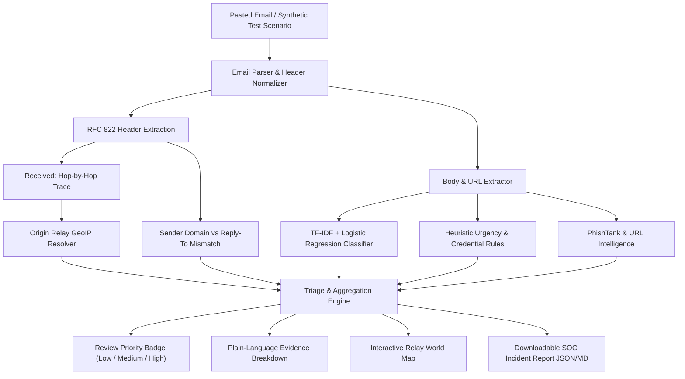

# AI-Powered Email Threat Detection, GeoLocation & Forensic Intelligence Platform

**Smart India Hackathon (SIH 2026)**  
- **Problem Statement ID:** `SIH26106`  
- **Theme:** Blockchain & Cybersecurity  
- **Team:** `<Hypnexis '26>`  
- **Institution:** Manipal University Jaipur  

---

## 📌 Problem Overview
Fraudulent and phishing emails routinely spoof trusted institutions, conceal deceptive redirects, and deploy psychological urgency triggers to force hasty decisions. 

This platform delivers a **human-in-the-loop screening and forensic triage aid** that:
1. Analyzes pasted email text or raw RFC 822 messages (no mailbox credentials or OAuth permissions required).
2. Deconstructs sender authentication headers, domain anomalies, and spoofing indicators.
3. Classifies linguistic threats using an explainable **TF-IDF + Logistic Regression** machine learning pipeline.
4. Traces hop-by-hop `Received:` mail transfer agents (MTAs) and visualizes the originating relay IP on an interactive world map.
5. Surfaces plain-language evidence, assigns a clear review priority (**LOW**, **MEDIUM**, **HIGH**), and exports structured incident reports for SOC triage.

---

## 🏗️ Architecture & Technical Approach



---

## 🚀 Key Features

* **Zero Mailbox Intrusion:** Fully software-only prototype; operates on user-submitted text without retaining or logging sensitive corporate mailboxes.
* **Explainable AI Classifier:** Fast scikit-learn pipeline highlights the exact vocabulary tokens (e.g. `urgent`, `suspended`, `password`, `wire transfer`) that drive threat confidence.
* **Relay GeoLocation & Hop Trace:** Extracts every intermediate IP along the mail delivery chain and visualizes the origin MTA on an interactive map.
* **Forensic Safe-Use Disclaimers:** Explicitly adheres to CISA guidelines noting that IP geolocation reflects intermediate relays, not legally conclusive proof of author identity.
* **Instant Offline Demo Mode:** Includes pre-loaded synthetic scenarios and an offline intelligence cache so the application runs with zero latency during live hackathon judging.
* **SOC Triage Export:** Generates standardized JSON and Markdown incident files for immediate ticket filing in Jira, ServiceNow, or SIEM platforms.

---

## ⚙️ Installation & Local Setup

### 1. Prerequisites
- Python 3.10+ (tested on Python 3.14)
- Pip

### 2. Install Dependencies
```bash
cd email-threat-forensics
pip install -r requirements.txt
```

### 3. Run the Web Application
```bash
python -m streamlit run app.py
```
Open your browser at `http://localhost:8501`.

---

## 🧪 Pre-Configured Test Scenarios
In the application sidebar, you can instantly test:
1. **High Risk (Spoofed Brand):** Counterfeit PayPal account suspension with malicious URLs and Moscow relay IP headers.
2. **High Risk (CEO Fraud):** Urgent wire transfer and gift card solicitation from a lookalike executive email.
3. **Medium Risk (Suspicious Alert):** IT Helpdesk password expiration notice concealing a shortened redirect link.
4. **Low Risk (Benign):** Authentic internal hackathon team sync and sprint schedule from Manipal University Jaipur.

---

## 🛡️ Safe Use & Forensic Disclaimers
* **Screening Aid:** This platform is designed to assist human analysts; automated blocking is omitted to prevent business disruption from false positives.
* **Geolocation Precision:** Geolocation reflects intermediate network infrastructure (relays/proxies), not the physical location of the attacker.
* **Data Privacy:** Submitted emails are processed ephemeral in-memory and are never stored or transmitted to external third-party model providers.

---

## 📚 References & Standards
- **SIH 2026 Master Catalogue:** Problem Statement `SIH26106`
- **CISA "Secure Our World":** Phishing Recognition & Reporting Guidelines (`cisa.gov`)
- **PhishTank:** Developer API & URL Reputation Feed (`phishtank.org`)
- **Scikit-Learn:** TF-IDF Vectorization & Logistic Regression (`scikit-learn.org`)
